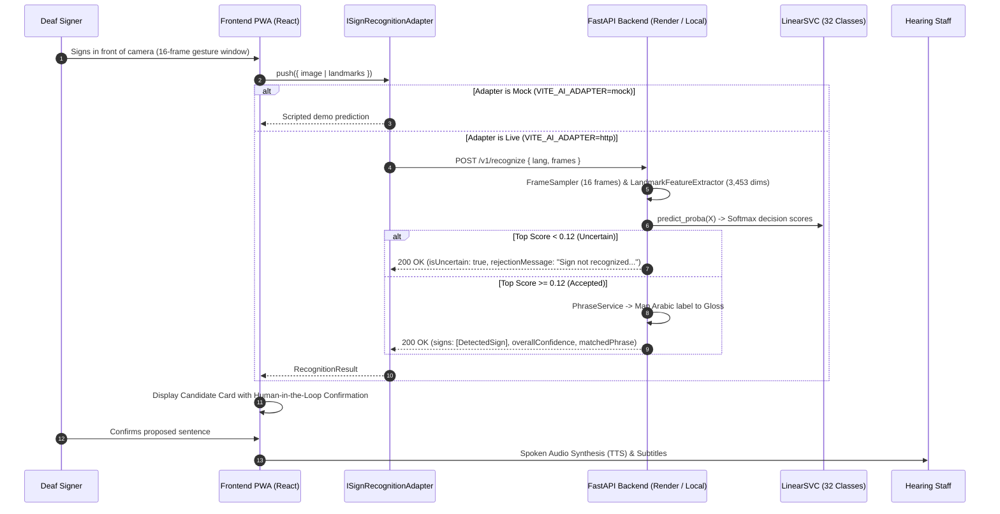

# ConnectSign — Every Hand Has a Voice

[](https://connect-sign-nine.vercel.app/)
[](https://connect-sign.onrender.com/health)
[](frontend/README.md#10-testing-and-quality-checks)
[](backend/README.md#10-testing-and-validation)
[](frontend/README.md#9-localization-and-accessibility)

> **"Every Hand Has a Voice"**  
> **"Chaque main a une voix"**  
> **"لكل يد صوت"**

---

## 1. Project Summary

**ConnectSign** is an installable, offline-first Progressive Web App (PWA) engineered to facilitate two-way assistive communication between signers of **Algerian Sign Language (LSA / لغة الإشارة الجزائرية)** and hearing non-signers. Developed specifically for frontline healthcare and civic counters—such as a Deaf patient consulting a pharmacist, clinical triage desk, or administrative receptionist without a certified human interpreter—ConnectSign pairs a client-side web application with a CPU-optimized machine-learning inference backend for isolated sign classification and deterministic phrasebook matching.

- **Live Application:** [https://connect-sign-nine.vercel.app](https://connect-sign-nine.vercel.app)
- **GitHub Repository:** [https://github.com/samia-djafi/connect_sign](https://github.com/samia-djafi/connect_sign)
- **Backend Health Probe:** [https://connect-sign.onrender.com/health](https://connect-sign.onrender.com/health)

---

## 2. Problem Statement and Target Users

### The Problem
In Algeria and across the Maghreb, more than 200,000 Deaf citizens encounter acute barriers when seeking medical consultations, explaining symptoms, or purchasing prescribed medications:
- **Scarcity of Certified Interpreters:** Professional sign-language interpreters are rarely available on-demand at community pharmacies or emergency clinic triage desks.
- **High-Risk Medical Misunderstandings:** Critical clinical details—including medication dosages, administration frequencies, durations, and contraindications—cannot safely rely on improvised gestures or rushed handwriting.
- **Distinct Linguistic Identity:** Algerian Sign Language (LSA) possesses its own visual-spatial syntax, vocabulary, and cultural conventions; it is not a manual transcription of spoken Algerian Arabic (Darja), Modern Standard Arabic, or French.
- **Intermittent Connectivity:** Public clinics and subterranean triage areas frequently suffer from poor or non-existent cellular connectivity, making cloud-only translation services unreliable.

### Intended Users
1. **Deaf and Hard-of-Hearing Patients:** Expressing symptoms, requesting medication, and understanding clinical instructions.
2. **Healthcare Staff (Pharmacists, Nurses, Receptionists):** Communicating dosages, frequencies, and triage instructions clearly in spoken/written French, Arabic, or English.
3. **Caregivers & Hearing Allies:** Supporting family members in everyday medical and administrative encounters.

---

## 3. What ConnectSign Currently Does

ConnectSign provides a structured, bidirectional communication workflow:

1. **Sign-to-Language (Patient $\rightarrow$ Staff):**
   - Ingests webcam video frames and captures hand/upper-body landmark coordinates.
   - Evaluates 16-frame gesture trajectories against a trained 32-class classifier on CPU.
   - Enforces an uncertainty rejection threshold ($< 0.12$) to reject ambiguous or non-sign gestures rather than hallucinating false predictions.
   - Requires explicit **human confirmation** before synthesized natural-language sentences are broadcast via text-to-speech (TTS).
2. **Language-to-Sign (Staff $\rightarrow$ Patient):**
   - Staff input spoken or written instructions in French, Arabic, or English.
   - Client-side Natural Language Processing extracts clinical slots (dosages, daily frequencies, treatment durations).
   - Maps parsed patterns to verified LSA gloss sequences via fuzzy Damerau-Levenshtein matching.
   - `SignPlayer` displays sequential sign tokens with synchronized multilingual subtitles.
3. **Frontline Emergency & Offline Tools:**
   - 1-click **Emergency Medical Sheet** for acute crises (chest pain, severe breathing difficulty, anaphylaxis, heavy bleeding).
   - Curated **87-phrase medical phrasebook** with instant trilingual search.
   - Conversation histories and favorites persist locally in IndexedDB (Dexie).

---

## 4. Implementation Status: Real vs. Prototype vs. Planned Work

| Capability | Scope / Implementation | Status |
|---|---|---|
| **Frontline Healthcare Phrasebook** | 87 curated phrases across 5 categories (symptoms, medication, appointments, emergencies, everyday) with instant search in FR, AR, EN. | **Implemented & Verified** |
| **Trilingual RTL/LTR Localization** | Complete parity across 730 translation keys in French, native RTL Arabic (mirrored layouts, logical CSS), and English. | **Implemented & Verified** |
| **Offline-First PWA Storage** | Workbox service worker asset pre-caching; all sessions, messages, and bookmarks persist locally in IndexedDB (Dexie). | **Implemented & Verified** |
| **Emergency Medical Sheet** | Instant full-screen distress cards with high-contrast visuals and localized audio alerts. | **Implemented & Verified** |
| **Medical Slot / Dosage Parser** | Client-side regex pattern extraction for dosages and frequencies (e.g. *"2 comprimés par jour pendant 5 jours"*). | **Implemented & Verified** |
| **Isolated ML Sign Recognition** | LinearSVC classifier with StandardScaler running on 3,453 spatio-temporal features across 32 isolated LSA signs. | **Implemented & Verified** |
| **Uncertainty Rejection Gating** | Rejection threshold ($< 0.12$) preventing hallucination of low-confidence or resting inputs. | **Implemented & Verified** |
| **Dual Adapter Architecture** | Decoupled `ISignRecognitionAdapter` allowing runtime switching between `live` (FastAPI backend) and `demo` (scripted mock). | **Implemented & Verified** |
| **`SignPlayer` Video Clips** | 54 sign dictionary entries cataloged in `manifest.json`. High-contrast status cards displayed while studio recordings are conducted. | **Prototype / In Production** |
| **Continuous Sign Translation** | Multi-sentence unsegmented continuous sign-to-text recognition without temporal pauses. | **Planned / Future Work** |
| **Automated Clinical Diagnosis** | Autonomous prescription or diagnostic reasoning. | **Explicitly Out of Scope** |

---

## 5. Architectural Overview and Inference Request Flow

ConnectSign operates on a local-first, decoupled architecture:



---

## 6. Technology Stack

| Domain | Technology | Version / Spec | Purpose in ConnectSign |
|---|---|---|---|
| **Frontend Framework** | React | `18.3.1` | Reactive UI component tree |
| **Language** | TypeScript | `5.7.2` | Static type safety and domain interfaces |
| **Build & PWA** | Vite & vite-plugin-pwa | `5.4.11` / `0.21.1` | Build tooling and Workbox service worker generation |
| **Styling** | Tailwind CSS | `3.4.17` | Accessible design tokens with high-contrast mode |
| **Client Storage** | Dexie.js | `4.0.11` | IndexedDB wrapper for local conversation persistence |
| **Localization** | i18next & react-i18next | `23.16.8` / `15.4.1` | Trilingual translation with RTL layout synchronization |
| **Backend Framework**| FastAPI | `^0.115.0` | Asynchronous REST routing and OpenAPI docs |
| **ASGI Server** | Uvicorn (standard) | `^0.30.0` | Production ASGI web server |
| **Classification** | scikit-learn | `^1.4.0` | Linear Support Vector Classifier (`LinearSVC`) with `StandardScaler` |
| **Serialization** | Joblib & NumPy | `^1.3.0` / `^1.26.0` | Model artifact persistence and array operations |
| **Vision Utilities** | OpenCV Headless | `^4.9.0` | Frame decoding and array transformations |
| **Testing** | Vitest & Pytest | `2.1.8` / `8.0.0` | Unit, integration, and deployment integrity tests |

---

## 7. Machine Learning Truth & Empirical Audit

### Origin of Class Counts: 32 Model Classes vs. 54 Interface Signs
To resolve the contradiction between historical counts:
1. **32 Output Classes (Machine-Learning Truth):**
   The trained serialized model artifact (`backend/models/best_model.joblib`) contains **exactly 32 output classes**. These correspond to the isolated sign samples from the VDzSL benchmark:
   `1`, `2`, `3`, `أذن` (Ear), `ألم` (Pain), `إبرة` (Injection), `الآن` (Now), `الليل` (Night), `بشرة` (Skin), `جسم` (Body), `حرارة` (Fever), `حسنا` (OK), `خطر` (Emergency/Danger), `رأس` (Head), `سكر` (Sugar/Diabetes), `شكرا` (Thank You), `صباح` (Morning), `طبيب أسنان` (Dentist), `طعام` (Food/Eat), `قلب` (Heart), `كحول` (Alcohol/Antiseptic), `كل يوم` (Every Day), `كم` (How Much/How Long), `لا` (No), `ماء` (Water), `مال` (Price/Money), `مريض` (Sick), `من فضلك` (Please), `نصف` (Half), `نعم` (Yes), `يد` (Hand), `يساعد` (Help).
2. **54 Interface Signs (Phrasebook / Text-to-Sign Dictionary):**
   In `frontend/src/data/vocabulary.config.ts`, there are **54 UI entries** used by the Text-to-Sign parser, phrasebook, and video player manifest (`manifest.json`). These 54 entries define the client-side phrase dictionary, **not** the ML model's output classes.

### Feature Preprocessing Pipeline ($D = 3{,}453$)
Features are extracted identically during training and inference across a 16-frame window:
- **Pose Vector:** 7 upper-body joints (nose, shoulders, elbows, wrists) normalized relative to torso center and divided by shoulder distance ($7 \times 3 = 21$ values/frame).
- **Hand Vectors:** For each hand (left and right): presence flag (1), wrist relative to torso (3), hand scale (1), 21 normalized landmarks relative to wrist (63), palm normal (3), palm direction (3), 5 fingertip distances (5), pinch distance (1) ($= 80$ values $\times 2 = 160$ values/frame).
- **Per-Frame Concatenation:** $21 + 160 = 181$ values per frame $\times 16$ frames $= 2{,}896$ dimensions.
- **Temporal Summary Statistics:** Mean (181), standard deviation (181), mean absolute consecutive difference (181), and wrist trajectory displacement/bounding metrics (14) $= 557$ dimensions.
- **Total Feature Dimension:** $2{,}896 + 557 = 3{,}453$ dimensions.

### Confidence Mechanism & Calibration Disclosure
- **Decision Function:** The classifier is `LinearSVC(C=0.5, dual=False, max_iter=2000, random_state=42)`.
- **Confidence Computation:** Raw signed margin distances from `model.decision_function(X_scaled)` are transformed into normalized prediction scores using a stable softmax function.
- **Calibration Status:** This is an **uncalibrated softmax transformation** over SVM margins; it has **not** undergone Platt scaling (`CalibratedClassifierCV`) or isotonic regression. ConnectSign therefore refers to this output as a **prediction score** or **decision confidence**, rather than a statistically calibrated posterior probability.
- **Abstention Gating:** Random chance across 32 classes is $3.125\%$. The backend applies an empirical uncertainty threshold (`UNCERTAINTY_THRESHOLD = 0.12`):
  - Score $\ge 0.22$: High confidence (`level: "high"`).
  - $0.12 \le \text{Score} < 0.22$: Medium confidence (`level: "medium"`).
  - Score $< 0.12$: Input rejected (`isUncertain: true`, prediction abstained, user prompted to retry).

### Real Evaluation Metrics (from `backend/models/config.json`)
The model was evaluated against a held-out test split of the VDzSL benchmark:
- **Dataset:** VDzSL Benchmark (Zenodo DOI: `10.5281/zenodo.18209839`, PMC12925472).
- **Population:** 4 avatars across 5 camera angles; 20 samples per class.
- **Training Samples:** 448
- **Test Samples:** 96
- **Test Accuracy:** **67.71%**
- **Test Macro F1:** **66.16%**
- **Mean Inference Latency:** **1.15 ms** on CPU

---

## 8. Installation and Fresh Clone Setup

### Prerequisites
- **Node.js:** `^18.0.0`, `^20.0.0`, or `^22.0.0`
- **npm:** `^9.0.0` or higher
- **Python:** `^3.10`, `^3.11`, or `^3.14`

### Clone the Repository
```bash
git clone https://github.com/samia-djafi/connect_sign.git
cd connect_sign
```

---

## 9. Launch Commands

### Running the Frontend
```bash
cd frontend

# 1. Install dependencies
npm install

# 2. Configure environment (uses safe production defaults out of the box)
cp .env.example .env

# 3. Start development server
npm run dev
```
Open [http://localhost:3000](http://localhost:3000) (or the port Vite outputs) in your browser.

### Running the Backend Locally
```bash
cd backend

# 1. Create and activate a virtual environment
python -m venv .venv

# On Windows PowerShell:
.\.venv\Scripts\Activate.ps1
# On Linux / macOS:
# source .venv/bin/activate

# 2. Install dependencies
pip install -r requirements-dev.txt

# 3. Launch the API server
uvicorn app.main:app --host 0.0.0.0 --port 8000 --reload
```
The API Swagger documentation will be available at [http://localhost:8000/docs](http://localhost:8000/docs).

To point your local frontend to your local backend, edit `frontend/.env`:
```ini
VITE_AI_ADAPTER=http
VITE_API_BASE_URL=http://localhost:8000
```

---

## 10. Environment Variables (Safe Placeholders)

### Frontend Configuration (`frontend/.env.example`)
| Variable | Default Value | Description |
|---|---|---|
| `VITE_APP_NAME` | `ConnectSign` | Application title displayed in headers and manifest |
| `VITE_AI_ADAPTER` | `http` | Active recognition adapter (`http` for live server, `mock` for demo) |
| `VITE_API_BASE_URL` | `https://connect-sign.onrender.com` | Base URL of the FastAPI recognition backend |
| `VITE_WS_URL` | `wss://connect-sign.onrender.com/ws/recognize` | WebSocket endpoint placeholder |
| `VITE_CONFIDENCE_THRESHOLD` | `0.70` | Default UI threshold for sign visual indicators |
| `VITE_CONFIDENCE_HIGH` | `0.85` | High-confidence threshold tier |
| `VITE_SEQUENCE_FRAMES` | `48` | Sliding window frame buffer size |
| `VITE_APP_VERSION` | `0.1.0` | Application semantic version |

### Backend Configuration (`backend/.env.example`)
| Variable | Default Value | Description |
|---|---|---|
| `ENVIRONMENT` | `development` | Runtime environment (`development` or `production`) |
| `HOST` | `0.0.0.0` | Network binding interface |
| `PORT` | `8000` | HTTP listening port |
| `MODEL_DIR` | `models` | Directory path containing model weights and task files |
| `UNCERTAINTY_THRESHOLD` | `0.12` | Minimum softmax prediction score before rejection |
| `MAX_FRAMES` | `48` | Maximum frame sequence threshold cap |
| `CORS_ORIGINS` | `["http://localhost:5173","http://localhost:3000","https://connect-sign-nine.vercel.app"]` | Allowed CORS origins (JSON array or comma-separated) |

---

## 11. API Endpoints and Verified Schemas

### 1. Health Probe (`GET /health`)
```bash
curl -X GET http://localhost:8000/health
```
**Response (200 OK):**
```json
{
  "status": "ok",
  "service": "ConnectSign AI Recognition API",
  "version": "0.2.0",
  "model_loaded": true,
  "model_name": "ConnectSign-LSA-Landmark-SVM",
  "active_vocabulary_classes": 32,
  "device": "cpu",
  "timestamp": 1729851234.56
}
```

### 2. Sign Recognition (`POST /v1/recognize`)
```bash
curl -X POST http://localhost:8000/v1/recognize \
  -H "Content-Type: application/json" \
  -d '{"lang":"fr","frames":[]}'
```

**Response (200 OK — Confident Detection):**
```json
{
  "signs": [
    {
      "gloss": "HELP",
      "confidence": 0.88,
      "level": "high",
      "atMs": 250
    }
  ],
  "sequence": ["HELP"],
  "overallConfidence": 0.88,
  "level": "high",
  "frames": 16,
  "latencyMs": 250,
  "model": {
    "name": "ConnectSign-LSA-Landmark",
    "version": "0.2.0"
  },
  "adapter": "live",
  "isUncertain": false,
  "rawPredictedLabel": "يساعد",
  "matchedPhrase": {
    "id": "ph_emergency_help",
    "category": "emergency",
    "text": {
      "fr": "Aidez-moi c'est une urgence !",
      "ar": "ساعدوني إنها حالة طارئة!",
      "en": "Help me it's an emergency!"
    },
    "gloss": ["HELP", "EMERGENCY"]
  },
  "supportStatus": "FULL_RECOGNITION",
  "topCandidates": [
    { "label": "يساعد", "score": 0.88 },
    { "label": "خطر", "score": 0.05 },
    { "label": "ماء", "score": 0.02 }
  ],
  "rejectionMessage": null
}
```

---

## 12. Testing and Quality Verification

ConnectSign maintains extensive automated test suites:

### Running Backend Tests (Pytest)
```bash
& "C:\Users\djafi.DESKTOP-6U93SOA\AppData\Local\Python\bin\python.exe" -m pytest backend/tests -v
```
**Results:** **13 passed** in 0.67s across 4 test suites:
- `test_deployment_integrity.py`: 4 tests (CORS parsing, frame caps, 32-class vocabulary integrity, self-contained classifier).
- `test_health.py`: 2 tests (`/health` probe and `/` alias).
- `test_phrases.py`: 3 tests (seed phrase retrieval, exact sequence matching, partial matching).
- `test_recognition.py`: 4 tests (missing frames rejection, empty frames rejection, synthetic landmark inference, blank frame rejection).

### Running Frontend Tests (Vitest)
```bash
npm --prefix frontend test
```
**Results:** **113 passed** across 17 test files in 82s:
- Unit tests: text normalization, fuzzy matching, language generation, profile storage.
- Integration tests: HTTP sign recognition adapter, settings store, session repository.
- UI tests: workspace interactions, conversation mode switching, emergency distress sheet, i18n parity.

### Typecheck & Production Build
```bash
npm --prefix frontend run build
```
**Results:** TypeScript compilation (`tsc`) and Vite bundling succeeded with **0 type errors** and generated the Workbox PWA service worker with 61 precached assets (1,297 KiB).

---

## 13. Known Limitations & Technical Honesty

1. **Synthetic Training Benchmark:** The underlying VDzSL model was trained on 3D avatar animations. While spatio-temporal normalization minimizes anatomical differences, natural webcam signing with background clutter or low lighting may degrade classification performance.
2. **Isolated Single-Sign Windowing:** Inference operates on 16-frame windows (~1.6 seconds) of isolated signs. ConnectSign does **not** perform continuous unpunctuated sign sentence transcription.
3. **Upper-Body Landmark Focus:** Current classification relies on hand geometry and upper-body pose. Non-manual markers (facial expressions, mouthing, eyebrow shifts) are not parsed by this model.
4. **Sign Video Assets in Production:** Curated LSA video clips are cataloged in `manifest.json`. During ongoing studio video production with Algerian Deaf native signers, `SignPlayer` displays an honest informational card detailing the verified gloss without fabricating synthetic animations.
5. **Cold Start Latency on Free Cloud Tiers:** The production backend is deployed on Render's free tier. Inactivity may spin down the instance; first requests after sleep can take 25–30 seconds. The frontend adapter includes a 25-second timeout and retry logic to accommodate this behavior.

---

## 14. Accessibility, Language Support & Offline Capabilities

- **Trilingual Parity:** 730 synchronized i18n keys across French, Arabic, and English with zero missing entries.
- **RTL-First Engineering:** Native Right-to-Left layout flow using CSS logical properties (`dir="rtl"`), font optimization with `IBM Plex Sans Arabic`, and mirrored icon directions.
- **WCAG 2.2 AA Contrast Compliance:** Strict prohibition of gradients on interactive surfaces; solid primary button contrast (#0F766E on white) achieves **5.4:1**, exceeding AA requirements.
- **Offline Data Privacy:** Patient conversations and bookmarks are stored exclusively on-device in IndexedDB (`connectsign`); no healthcare interaction data is logged or transmitted to external servers.

---

## 15. Thirduni Program & Acknowledgments

ConnectSign was developed as the final capstone project of **Thirduni**, a competitive leadership and technological innovation initiative associated with the **U.S. Embassy in Algeria**.

- **Dataset Attribution:** Machine-learning models are trained on the VDzSL benchmark (Zenodo DOI: `10.5281/zenodo.18209839`, PMC12925472).
- **Community Partnership:** ConnectSign was designed with continuous consultation from members of the Algerian Deaf community to respect the linguistic sovereignty and cultural dignity of Algerian Sign Language.

💚 **ConnectSign — Every Hand Has a Voice.**
