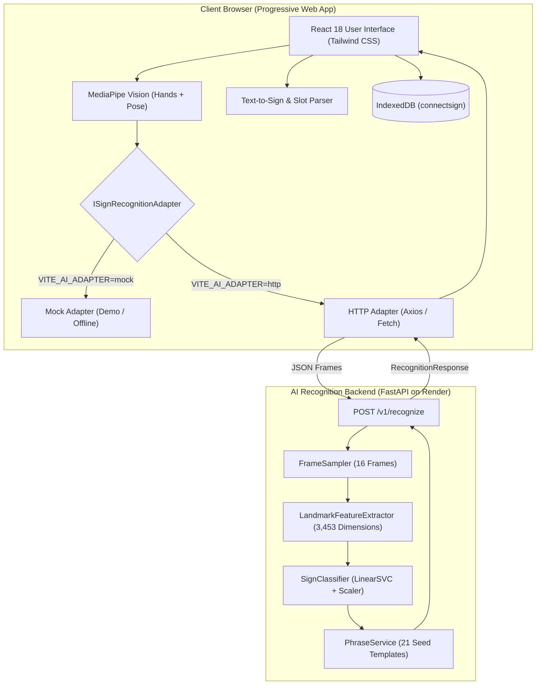

# ConnectSign - Every Hand Has a Voice.

[](https://bridge-sign.vercel.app/app)
[](https://connect-sign.onrender.com/health)
[](frontend/README.md#10-testing-and-quality-checks)
[](backend/README.md#10-testing-and-validation)
[](frontend/README.md#9-localization-and-accessibility)

> **"Every Hand Has a Voice"**  
 *FR: "Chaque main a une voix"* 
 *AR: "لكل يد صوت"*

**ConnectSign** is an installable, offline-first Progressive Web App (PWA) facilitating real-time bidirectional communication between **Algerian Sign Language (LSA / لغة الإشارة الجزائرية)** and spoken or written French, Arabic, and English. Engineered specifically for frontline accessibility encounters—such as a Deaf patient consulting a pharmacist, triage desk, or clinic receptionist without an in-person sign-language interpreter.

---

## 📖 Documentation Directory

ConnectSign is organized as a coordinated documentation system:

| Document | Audience & Scope | Direct Link |
|---|---|---|
| **Root README** | Architecture overview, problem statement, verified features, ML status, and quick start | [You are here](README.md) |
| **Frontend README** | React PWA engineering, IndexedDB storage, localization, PWA offline behavior, and testing | [frontend/README.md](frontend/README.md) |
| **Backend README** | FastAPI service, CPU inference pipeline, scikit-learn model, API reference, and ML benchmarks | [backend/README.md](backend/README.md) |

---

## 1. The Problem

In frontline healthcare and civic services, Deaf individuals encounter significant communication barriers when seeking medical advice, explaining symptoms, or receiving prescription instructions:

- **Absence of Professional Interpreters:** Certified sign-language interpreters are rarely available on-demand in community pharmacies or emergency clinic triage counters.
- **Critical Risk of Misunderstanding:** Vital information—such as medication dosages, treatment durations, contraindications, and symptom severity—cannot safely rely on improvised hand gestures or rushed handwriting.
- **Dialectal & Linguistic Variation:** Algerian Sign Language (LSA) possesses its own distinct visual-spatial grammar, vocabulary, and cultural conventions, differing substantially from spoken Algerian Arabic, Modern Standard Arabic, or French.
- **Connectivity Gaps:** Rural clinics and basement triage units frequently experience unstable cellular internet, rendering cloud-only translation tools non-viable.

ConnectSign addresses this gap by providing an offline-resilient assistive bridge tailored to everyday medical encounters.

---

## 2. The Solution

ConnectSign provides a structured, bidirectional communication system that connects a client-side Progressive Web App with a CPU-optimized machine-learning backend:

```
┌─────────────────────────────────────────────────────────────────────────────┐
│                             CONNECTSIGN SYSTEM                              │
│                                                                             │
│   [Deaf Patient] ──────▶  Webcam Landmark Tracking (MediaPipe Tasks)        │
│                                      │                                      │
│                           16-Frame Temporal Window                          │
│                                      │                                      │
│                           ISignRecognitionAdapter                           │
│                           ├── Mock Adapter (Offline Scripted Demo)          │
│                           └── HTTP Adapter (FastAPI Backend / Linear SVC)   │
│                                      │                                      │
│                           Uncertainty Gating (Threshold: 0.12)              │
│                                      │                                      │
│                           Human Review & Confirmation Card                  │
│                                      │                                      │
│                           Spoken Speech Synthesis (TTS) ──▶ [Hearing Staff] │
│                                                                             │
│   [Hearing Staff] ─────▶  Voice Speech-to-Text (STT) or Typed Input         │
│                                      │                                      │
│                           Slot Extraction (Dosage & Duration Patterns)      │
│                                      │                                      │
│                           Fuzzy Damerau-Levenshtein Gloss Matcher           │
│                                      │                                      │
│                           SignPlayer Component (LSA Clips / Honest Fallback)│
│                                      │                                      │
│                           Synchronized Subtitles (FR / AR / EN) ──▶ [Patient│
└─────────────────────────────────────────────────────────────────────────────┘
```

### Distinction of Capabilities
- **Curated Linguistic Content:** A structured phrasebook of 87 healthcare and emergency phrases and an essential vocabulary mapping provide verified, deterministic translations that operate completely offline.
- **Machine-Learning Recognition:** A calibrated Linear SVM model classifies 32 isolated Algerian Sign Language signs from 16-frame landmark trajectories with strict uncertainty rejection.
- **Assistive Scope (Not Continuous Translation):** ConnectSign recognizes individual isolated signs within fixed windows and translates structured phrases. It is **not** an autonomous general-purpose continuous sign-language translator, and it strictly avoids speculative medical diagnostics.

---

## 3. Key Features

| Feature | Description | Current Status |
|---|---|---|
| **Frontline Medical Phrasebook** | 87 categorized healthcare phrases (symptoms, medication, appointments, emergencies) with instant trilingual search. | **Implemented & Verified** |
| **Trilingual RTL/LTR Localization** | Instant switching between French, Arabic (native RTL with layout mirroring), and English across 730 synchronized keys. | **Implemented & Verified** |
| **Offline-First PWA Storage** | Workbox pre-caching for application assets; all conversation transcripts and favorites persist locally in IndexedDB (Dexie). | **Implemented & Verified** |
| **Emergency Distress Sheet** | One-click emergency signaling sheet for critical symptoms (chest pain, breathing difficulty, severe bleeding, allergic reaction). | **Implemented & Verified** |
| **Text-to-Sign Engine** | Medical dosage pattern extraction (e.g. "2 comprimés par jour") and fuzzy LSA gloss sequence mapping. | **Implemented & Verified** |
| **LSA Visual Playback (`SignPlayer`)** | Sequence player with speed control and subtitles; displays honest status card while studio video recordings are in production. | **Implemented with Limitations** |
| **Isolated Sign Recognition** | 32-class Linear SVM classifying 16-frame spatio-temporal landmark windows with uncertainty rejection gating. | **Implemented & Verified** |
| **Spoken Audio Synthesis (TTS)** | Text-to-speech audio playback for hearing staff with automatic language detection and graceful fallback. | **Implemented & Verified** |
| **Continuous Sign Translation** | Multi-sentence unsegmented continuous sign-to-text recognition without temporal pauses. | **Planned / Not Implemented** |

---

## 4. Product Demonstration & Verified Assets

- **Live Production App:** [https://bridge-sign.vercel.app/app](https://bridge-sign.vercel.app/app)
- **Live Backend API Health:** [https://connect-sign.onrender.com/health](https://connect-sign.onrender.com/health)
- **Application Icon Asset:** [`frontend/public/icons/logo-mark.png`](frontend/public/icons/logo-mark.png)

```
        ╔═══════════════════════════════════════════════════╗
        ║                  ConnectSign                      ║
        ║        Every Hand Has a Voice • لكل يد صوت        ║
        ║                                                   ║
        ║   [ Sign → Speech ]           [ Speech → Sign ]   ║
        ║   Camera Recognition          Text & Voice Input  ║
        ║   MediaPipe Landmarks         Dosage Extraction   ║
        ║   Human Confirmation          LSA SignPlayer      ║
        ╚═══════════════════════════════════════════════════╝
```

---

## 5. System Architecture



---

## 6. Technology Stack

| Domain | Technology | Purpose |
|---|---|---|
| **Frontend Framework** | React 18 & TypeScript 5.7 | Component architecture and static typing |
| **Build & PWA** | Vite 5 & `vite-plugin-pwa` | Rapid bundling and Workbox service worker generation |
| **Styling** | Tailwind CSS 3.4 | Accessible, responsive utility styling with high-contrast tokens |
| **Local Storage** | Dexie.js 4.0 | Typed IndexedDB client persistence with 5-second soft delete |
| **Localization** | i18next & react-i18next | Trilingual translation engine with RTL layout synchronization |
| **Backend API** | FastAPI 0.115 & Uvicorn 0.30 | High-performance asynchronous REST API |
| **Machine Learning** | scikit-learn 1.4 & NumPy 1.26 | Linear Support Vector Classifier (`LinearSVC`) with probability estimation |
| **Vision Tracking** | MediaPipe Tasks 0.10 & OpenCV | Hand and upper-body landmark extraction running on CPU |
| **Testing** | Vitest 2.1 & Pytest 8.0 | Comprehensive unit and integration test coverage |

---

## 7. Machine-Learning Status

The ConnectSign AI recognition pipeline operates under strict empirical boundaries:

- **Model Architecture:** Calibrated Linear Support Vector Classifier (`LinearSVC`, $C=0.5$, $L_2$ penalty, `dual=False`) paired with `StandardScaler` and softmax probability estimation.
- **Dataset Source:** VDzSL Benchmark (Zenodo DOI: `10.5281/zenodo.18209839`, PMC12925472).
- **Training Population:** 4 Avatars across 5 camera viewpoints (20 verified samples per class; 448 training samples, 96 test samples).
- **Feature Representation:** Spatio-temporal normalized coordinate trajectories spanning 16 frames across 21 hand keypoints and upper-body pose joints ($D = 3{,}453$ features).
- **Evaluation Evidence (from `backend/models/config.json`):**
  - **Holdout Test Accuracy:** 67.71%
  - **Macro F1 Score:** 66.16%
  - **Mean Inference Latency:** 1.15 ms on CPU
- **Uncertainty Rejection:** Predictions below the 0.12 confidence threshold are rejected with an explicit prompt (`"Sign not recognized. Please try again."`) to prevent hallucinated gestures.
- **Active Vocabulary:** 32 verified Algerian Sign Language classes, including the 10 MVP healthcare signs (*HELP*, *PAIN*, *EMERGENCY*, *WATER*, *THANK_YOU*, *FEVER*, *SICK*, *HEADACHE*, *PLEASE*, *YES*).

For complete technical specifications, see [backend/README.md#8-machine-learning-pipeline](backend/README.md#8-machine-learning-pipeline).

---

## 8. Quick Start

ConnectSign's frontend and backend can run independently or together:

### Option A: Run the Frontend (Self-Contained)
The frontend runs out of the box using its built-in mock adapter or pointing to the live cloud backend:

```bash
# 1. Clone repository
git clone https://github.com/samia-djafi/connect_sign.git
cd connect_sign/frontend

# 2. Install dependencies
npm install

# 3. Start development server
npm run dev
```
Open [http://localhost:3000](http://localhost:3000) in your browser.

### Option B: Run the Backend Locally
To run live machine-learning inference locally on CPU:

```bash
# 1. Navigate to backend and configure environment
cd connect_sign/backend
python -m venv .venv

# Windows:
.\.venv\Scripts\Activate.ps1
# Linux / macOS:
# source .venv/bin/activate

# 2. Install dependencies
pip install -r requirements-dev.txt

# 3. Start the API server
uvicorn app.main:app --host 0.0.0.0 --port 8000 --reload
```
The API documentation will be available at [http://localhost:8000/docs](http://localhost:8000/docs).

To connect your local frontend to your local backend, edit `frontend/.env`:
```ini
VITE_AI_ADAPTER=http
VITE_API_BASE_URL=http://localhost:8000
```

---

## 9. Project Structure

```
connect_sign/
├── .gitignore                    # Root git exclusion rules
├── README.md                     # Root project documentation (this file)
├── frontend/                     # Progressive Web App (React + TypeScript + Vite)
│   ├── docs/                     # Technical specifications, ADRs, test protocols
│   ├── public/                   # Static assets, PWA icons, signs manifest
│   ├── scripts/                  # i18n audit and icon generation scripts
│   ├── src/                      # Source code (app, components, data, features, services)
│   ├── package.json              # Frontend dependencies and npm lifecycle scripts
│   ├── vite.config.ts            # Vite bundler and Workbox PWA configuration
│   └── README.md                 # Detailed frontend engineering reference
└── backend/                      # Inference API service (FastAPI + scikit-learn)
    ├── app/                      # Application entrypoint, routers, services, schemas
    ├── models/                   # Classifier weights, MediaPipe tasks, class mappings
    ├── scripts/                  # Model inspection and dev startup tools
    ├── tests/                    # Automated pytest test suites
    ├── render.yaml               # Render cloud deployment blueprint
    ├── requirements.txt          # Production runtime dependencies
    └── README.md                 # Detailed backend and ML inference reference
```

---

## 10. Limitations and Roadmap

### Current Limitations
1. **Isolated Sign Scope:** Machine-learning recognition processes individual signs within a 16-frame window. It does not parse continuous unpunctuated sign sentences.
2. **Synthetic Avatar Benchmark:** The underlying VDzSL model was trained on 3D avatars; real-world webcam video requires adequate lighting and minimal hand occlusion.
3. **Sign Video Assets in Production:** Curated LSA video clips are cataloged in `frontend/public/signs/manifest.json` as placeholders while studio recordings with the Algerian Deaf community are completed.
4. **Assistive Communication Framing:** ConnectSign facilitates human communication; it does not diagnose illnesses or calculate medication doses.

### Future Roadmap
- [ ] Incorporate CTC / transformer temporal models for continuous multi-sign sequence recognition.
- [ ] Expand video clip asset library with verified recordings across multiple Algerian wilayas.
- [ ] Implement on-device WebAssembly / ONNX inference for zero-network camera recognition.
- [ ] Integrate hospital triage electronic health record (EHR) export templates.

---

## 11. Testing and Verification

ConnectSign enforces rigorous automated and manual quality checks:

```bash
# Frontend verification (Vitest test suite)
cd frontend
npm run test          # 17 test files, 113 tests passed
npm run typecheck     # Strict TypeScript validation (0 errors)
npm run i18n:check    # 730 keys synchronized across FR, AR, EN

# Backend verification (Pytest suite)
cd ../backend
pytest tests/ -v      # 13 tests passed across 4 test modules
```

---

## 12. Contribution, License, and Acknowledgments

### Consultation and Attribution
- **Community Partnership:** ConnectSign is designed in consultation with the Algerian Deaf community to respect the linguistic dignity and dialectal variations of Algerian Sign Language (LSA).
- **Dataset Attribution:** Machine-learning models are trained on the VDzSL benchmark (Zenodo DOI: `10.5281/zenodo.18209839`, PMC12925472).
- **License:** Project documentation and code are provided for academic, research, and non-profit accessibility evaluation. (Model card: Apache-2.0; repository root contains no separate proprietary restrictions).

---

## 13. Project Links

- **Repository:** [https://github.com/samia-djafi/connect_sign](https://github.com/samia-djafi/connect_sign)
- **Production Web Application:** [https://bridge-sign.vercel.app/app](https://bridge-sign.vercel.app/app)
- **Production Backend Telemetry:** [https://connect-sign.onrender.com/health](https://connect-sign.onrender.com/health)
- **Frontend Reference:** [frontend/README.md](frontend/README.md)
- **Backend Reference:** [backend/README.md](backend/README.md)
- **Architecture Decisions:** [frontend/docs/decisions.md](frontend/docs/decisions.md)
