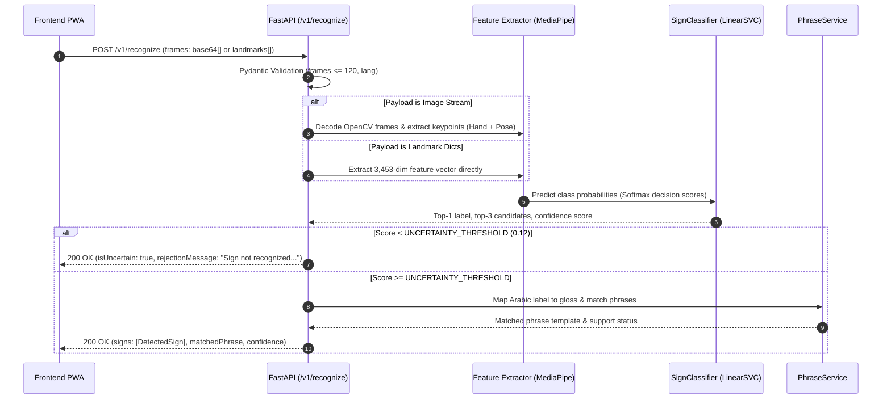

# ConnectSign AI - FastAPI Recognition Backend

[](tests/)
[](requirements.txt)
[](app/main.py)
[](https://connect-sign.onrender.com/health)

A CPU-optimized, local-first inference backend for **ConnectSign - Every Hand Has a Voice**, providing isolated sign recognition for Algerian Sign Language in frontline medical and pharmacy settings.

- **Production Health Probe:** [https://connect-sign.onrender.com/health](https://connect-sign.onrender.com/health)

---

## 1. Backend Overview

The ConnectSign backend delivers lightweight machine-learning inference for webcam video frames and pre-extracted MediaPipe landmarks. It is purpose-built to run locally on resource-constrained hardware (such as an Intel Core i5 with 8 GB RAM and no dedicated GPU) or deployed as a containerized web service.

### Core Responsibilities
- **Sign Recognition:** Ingests 16-frame webcam sequences (base64 JPEG images or normalized landmark coordinates) and classifies isolated Algerian Sign Language gestures.
- **Uncertainty Calibration & Rejection:** Rejects low-confidence or ambiguous gestures (confidence $< 0.12$) with an explicit rejection message rather than hallucinating unsupported words.
- **Phrase Alignment:** Maps predicted signs and sign sequences against healthcare communication templates.
- **Health & Readiness Telemetry:** Exposes probes reporting model readiness, active vocabulary size, and inference hardware target.

---

## 2. Architecture and Request Lifecycle

The backend handles requests through a modular pipeline separating network ingress, input validation, feature extraction, linear classification, and phrase matching:



### Request Lifecycle Phases
1. **Validation:** Pydantic v2 validates payload size, types, and frame caps (maximum 120 frames).
2. **Decoding / Sampling:** If raw images are provided, frames are decoded with OpenCV; `FrameSampler` samples exactly 16 frames across the temporal window.
3. **Feature Extraction:** `LandmarkFeatureExtractor` computes 21 3D coordinates per hand and upper-body pose joints using MediaPipe Tasks (`hand_landmarker.task` and `pose_landmarker_lite.task`), concatenating coordinate trajectories with temporal summary statistics into a single 3,453-dimensional vector.
4. **Classification:** `SignClassifier` standardizes features (`StandardScaler`) and evaluates decision scores (`LinearSVC`), applying a softmax transformation to compute normalized class probabilities.
5. **Gating & Phrasebook Lookup:** If the top prediction exceeds the rejection threshold (`0.12`), the label maps to its canonical gloss, and `PhraseService` matches corresponding phrases.

---

## 3. Technology Stack

| Layer | Technology | Version / Specification | Role |
|---|---|---|---|
| **API Framework** | FastAPI | `^0.115.0` | High-performance asynchronous HTTP routing and OpenAPI generation |
| **ASGI Server** | Uvicorn (standard) | `^0.30.0` | Production ASGI web server |
| **Validation** | Pydantic & Pydantic-Settings | `^2.8.0` / `^2.4.0` | Schema validation and typed environment configuration |
| **Classification** | scikit-learn | `^1.4.0` | `LinearSVC` pipeline with `StandardScaler` |
| **Landmark Tasks** | MediaPipe | `^0.10.14` | Hand and Pose landmarker tasks running on CPU |
| **Vision Utilities** | OpenCV Headless | `^4.9.0` | Image frame decoding and array operations |
| **Serialization** | Joblib & NumPy | `^1.3.0` / `^1.26.0` | Classifier model artifact persistence and numerical operations |
| **Testing** | Pytest & HTTPX | `^8.0.0` / `^0.27.0` | Automated endpoint validation and regression testing |

---

## 4. Project Structure

```
backend/
├── app/
│   ├── api/
│   │   └── routes/
│   │       ├── health.py              # GET /health, GET /
│   │       ├── phrases.py             # GET /v1/phrases, POST /v1/match
│   │       └── recognition.py         # POST /v1/recognize
│   ├── core/
│   │   └── config.py                  # Typed BaseSettings, dynamic CORS parsing
│   ├── ml/                            # Self-contained ML package
│   │   ├── classifier.py              # SignClassifier (LinearSVC wrapper + Softmax)
│   │   ├── feature_extractor.py       # LandmarkFeatureExtractor (MediaPipe Tasks)
│   │   └── frame_sampler.py           # Deterministic temporal frame sampling
│   ├── schemas/
│   │   └── recognition.py             # Pydantic schemas (Request, Response, Health)
│   ├── services/
│   │   ├── inference.py               # Singleton model loading, decoding, gating
│   │   └── phrase_service.py          # 21 seed healthcare phrases & gloss mappings
│   ├── __init__.py
│   └── main.py                        # FastAPI application entrypoint and lifespan
├── models/
│   ├── best_model.joblib              # Calibrated LinearSVC classifier (~833 KB)
│   ├── config.json                    # Hyperparameters, feature dimensions, evaluation metrics
│   ├── mvp_classes.json               # 32 active classes mapping (ID <-> Arabic label)
│   ├── hand_landmarker.task           # MediaPipe Hand landmarker model (~7.8 MB)
│   ├── pose_landmarker_lite.task      # MediaPipe Pose landmarker model (~5.8 MB)
│   └── README.md                      # Model provenance and specification documentation
├── scripts/
│   ├── inspect_model.py               # Model artifact inspection and verification tool
│   └── run_dev.py                     # Development startup wrapper
├── tests/
│   ├── conftest.py                    # Test fixtures and TestClient configuration
│   ├── test_deployment_integrity.py   # CORS, frame safety limits, vocabulary checks
│   ├── test_health.py                 # Health and readiness probe tests
│   ├── test_phrases.py                # Phrase listing and exact matching tests
│   └── test_recognition.py            # Recognition validation and uncertainty rejection tests
├── .env.example                       # Environment configuration template
├── .gitignore                         # Python cache, virtualenv, and log ignore rules
├── README.md                          # This documentation
├── render.yaml                        # Render blueprint deployment specification
├── requirements.txt                   # Production runtime dependencies
└── requirements-dev.txt               # Testing and development dependencies
```

---

## 5. Prerequisites and Installation

### Prerequisites
- **Python:** 3.10 to 3.14 (64-bit). Tested on Python 3.11.10 (Render Linux) and Python 3.14.7 (Windows).
- **Memory:** Minimum 4 GB RAM (8 GB recommended).
- **GPU:** Not required. Inference runs entirely on CPU.

### Step 1: Create and Activate a Virtual Environment

**Windows (PowerShell):**
```powershell
cd backend
python -m venv .venv
.\.venv\Scripts\Activate.ps1
```

**Linux / macOS:**
```bash
cd backend
python3 -m venv .venv
source .venv/bin/activate
```

### Step 2: Install Dependencies

For local execution and testing:
```bash
pip install --upgrade pip
pip install -r requirements-dev.txt
```

### Step 3: Inspect Model Artifacts

Run the verification tool to confirm model integrity, vocabulary classes, and dummy inference:
```bash
python scripts/inspect_model.py --model-dir models
```

### Step 4: Run Automated Tests
```bash
pytest tests/ -v
```

### Step 5: Start the Development Server
```bash
uvicorn app.main:app --host 0.0.0.0 --port 8000 --reload
```

Interactive API documentation will be available at:
- **Swagger UI:** [http://localhost:8000/docs](http://localhost:8000/docs)
- **ReDoc:** [http://localhost:8000/redoc](http://localhost:8000/redoc)

---

## 6. Configuration and Environment Variables

The backend uses `pydantic-settings` to load settings from environment variables or a local `.env` file:

| Variable | Type | Default | Description |
|---|---|---|---|
| `ENVIRONMENT` | string | `development` | Runtime environment (`development`, `production`). |
| `HOST` | string | `0.0.0.0` | Network binding interface. |
| `PORT` | integer | `8000` | HTTP listening port. |
| `MODEL_DIR` | string | `models` | Directory path containing model artifacts. |
| `UNCERTAINTY_THRESHOLD` | float | `0.12` | Minimum softmax probability to accept a prediction. |
| `MAX_FRAMES` | integer | `48` | Maximum frame sequence threshold. |
| `CORS_ORIGINS` | string / list | `["http://localhost:5173", "http://localhost:3000", ...]` | Allowed CORS origins. Accepts JSON array or comma-separated URLs. |

### Dynamic CORS Parsing
The settings parser automatically handles trailing slashes, JSON-stringified arrays from hosting dashboards, and bare hostnames (automatically prefixing `https://`). It also matches all `https://*.vercel.app` preview deployments via regex.

---

## 7. API Reference

### 7.1 Health & Readiness Probe
- **Method:** `GET`
- **Path:** `/health` (also aliased at `/`)
- **Purpose:** Verifies service uptime, model loading state, and active class count.

**Response (200 OK):**
```json
{
  "status": "ok",
  "service": "ConnectSign AI Recognition API",
  "version": "0.2.0",
  "model_loaded": true,
  "model_name": "BridgeSign-LSA-Landmark-SVM",
  "active_vocabulary_classes": 32,
  "device": "cpu",
  "timestamp": 1729851234.56
}
```

**Curl Example:**
```bash
curl -X GET http://localhost:8000/health
```

---

### 7.2 Recognize Sign Sequence
- **Method:** `POST`
- **Path:** `/v1/recognize`
- **Purpose:** Ingests webcam video frames (base64) or pre-extracted landmark dictionaries, executes classification, evaluates uncertainty, and returns predicted sign with matched phrase.

**Request Schema (`RecognitionRequest`):**
| Field | Type | Required | Description |
|---|---|---|---|
| `frames` | Array | Yes | Array of base64 image strings or `LandmarkFrame` dictionaries (1 to 120 frames). |
| `lang` | String | No | Target language context (`fr`, `ar`, `en`). Defaults to `fr`. |

**Sample Request (Synthetic Landmark Input):**
```json
{
  "lang": "fr",
  "frames": [
    {
      "t": 0,
      "hands": [[{"x": 0.5, "y": 0.5, "z": 0.0}]],
      "pose": [{"x": 0.5, "y": 0.3, "z": 0.0}]
    }
  ]
}
```

**Response (200 OK — Confident Detection):**
```json
{
  "signs": [
    {
      "gloss": "PAIN",
      "confidence": 0.384,
      "level": "high",
      "atMs": 18
    }
  ],
  "sequence": ["PAIN"],
  "overallConfidence": 0.384,
  "level": "high",
  "frames": 16,
  "latencyMs": 18,
  "model": {
    "name": "BridgeSign-LSA-Landmark",
    "version": "0.2.0"
  },
  "adapter": "live",
  "isUncertain": false,
  "rawPredictedLabel": "ألم",
  "matchedPhrase": {
    "id": "ph_pain",
    "category": "symptoms",
    "text": {
      "fr": "J'ai mal.",
      "ar": "أشعر بألم.",
      "en": "I have pain."
    },
    "gloss": ["PAIN"]
  },
  "supportStatus": "FULL_RECOGNITION",
  "topCandidates": [
    { "label": "ألم", "score": 0.384 },
    { "label": "حرارة", "score": 0.082 },
    { "label": "مريض", "score": 0.065 }
  ],
  "rejectionMessage": null
}
```

**Response (200 OK — Rejected / Uncertain Input):**
```json
{
  "signs": [],
  "sequence": [],
  "overallConfidence": 0.0,
  "level": "low",
  "frames": 16,
  "latencyMs": 15,
  "model": {
    "name": "BridgeSign-LSA-Landmark",
    "version": "0.2.0"
  },
  "adapter": "live",
  "isUncertain": true,
  "rawPredictedLabel": "ماء",
  "matchedPhrase": null,
  "supportStatus": "NO_MATCH",
  "topCandidates": [
    { "label": "ماء", "score": 0.085 },
    { "label": "خطر", "score": 0.071 },
    { "label": "يد", "score": 0.062 }
  ],
  "rejectionMessage": "Sign not recognized. Please try again."
}
```

**Error Status Codes:**
- `422 Unprocessable Entity`: Missing `frames` field or frame count exceeds 120.
- `503 Service Unavailable`: Model weights are not loaded into memory.

**Curl Example:**
```bash
curl -X POST http://localhost:8000/v1/recognize \
  -H "Content-Type: application/json" \
  -d '{"lang":"fr","frames":[]}'
```

---

### 7.3 List Seed Phrases
- **Method:** `GET`
- **Path:** `/v1/phrases`
- **Purpose:** Returns the 21 healthcare seed phrases configured in the backend phrase service.

**Response (200 OK):**
```json
{
  "total_phrases": 21,
  "phrases": [
    {
      "id": "ph_headache",
      "category": "symptoms",
      "text": {
        "fr": "J'ai mal à la tête.",
        "ar": "عندي صداع في الرأس.",
        "en": "I have a headache."
      },
      "gloss": ["HEADACHE"],
      "contexts": ["healthcare"]
    }
  ]
}
```

**Curl Example:**
```bash
curl -X GET http://localhost:8000/v1/phrases
```

---

### 7.4 Match Sign Tokens
- **Method:** `POST`
- **Path:** `/v1/match`
- **Purpose:** Matches an ordered sequence of sign gloss tokens against phrasebook templates.

**Request Schema:**
```json
{
  "signs": ["PAIN"]
}
```

**Response (200 OK):**
```json
{
  "matches": [
    {
      "phrase": {
        "id": "ph_pain",
        "category": "symptoms",
        "text": {
          "fr": "J'ai mal.",
          "ar": "أشعر بألم.",
          "en": "I have pain."
        },
        "gloss": ["PAIN"],
        "contexts": ["healthcare"]
      },
      "match_type": "EXACT",
      "score": 1.0,
      "support_status": "FULL_RECOGNITION"
    }
  ]
}
```

**Curl Example:**
```bash
curl -X POST http://localhost:8000/v1/match \
  -H "Content-Type: application/json" \
  -d '{"signs":["PAIN"]}'
```

---

## 8. Machine-Learning Pipeline

### Model Specification
- **Classifier:** Calibrated Linear Support Vector Classifier (`LinearSVC`, $C=0.5$, $L_2$ penalty, `dual=False`) wrapped with `StandardScaler` and softmax decision score estimation.
- **Dataset Source:** VDzSL Benchmark (Zenodo DOI: `10.5281/zenodo.18209839`, PMC12925472).
- **Training Population:** 4 Avatars (`signer0` through `signer3`) recorded across 5 viewpoints (`cam0` through `cam4`), providing 20 verified samples per class.
- **Sample Distribution:** 448 training samples, 96 holdout test samples.
- **Feature Dimension:** 3,453 spatio-temporal features per 16-frame window.
- **Evaluation Evidence (from `models/config.json`):**
  - **Test Accuracy:** 67.71%
  - **Macro F1 Score:** 66.16%
  - **Mean Inference Latency:** 1.15 ms on CPU

## 9. Model Artifacts and Data Requirements

All required model files reside in the `backend/models/` directory and are tracked directly in the repository:

| Artifact File | Size | Role |
|---|---|---|
| `best_model.joblib` | ~833 KB | Serialized scikit-learn classifier pipeline |
| `config.json` | ~1.1 KB | Hyperparameters, feature dimensions, and target class names |
| `mvp_classes.json` | ~7.8 KB | Numerical ID to Arabic label mappings and metadata |
| `hand_landmarker.task` | ~7.8 MB | MediaPipe Hand Landmarker model (21 keypoints per hand) |
| `pose_landmarker_lite.task` | ~5.8 MB | MediaPipe Pose Landmarker model (upper body skeleton) |

Models are loaded once during application startup by the lifespan handler in `app.main`. If artifacts are missing, the server starts in a degraded state (`status: "degraded"`, `model_loaded: false`) without crashing.

---

## 10. Testing and Validation

The test suite validates input parsing, rejection thresholds, model integrity, and CORS parsing:

```bash
# Run the complete test suite
pytest tests/ -v
```

### Verified Test Suite (13 Tests Passing)
- `tests/test_deployment_integrity.py`:
  - `test_cors_settings_parsing`: Validates JSON lists, comma-separated strings, and bare hostname formatting.
  - `test_request_max_frames_validation`: Confirms requests exceeding 120 frames return HTTP 422.
  - `test_model_loaded_and_vocabulary_integrity`: Confirms all 32 classes load with verified Arabic labels.
  - `test_self_contained_classifier`: Validates CPU inference on dummy 3,453-dim vectors.
- `tests/test_health.py`:
  - `test_health_endpoint`: Checks `/health` response structure and status.
  - `test_root_endpoint`: Verifies `/` alias.
- `tests/test_phrases.py`:
  - `test_list_phrases`: Verifies retrieval of seed phrases.
  - `test_match_phrases_exact`: Tests exact matching for `PAIN`.
  - `test_match_phrases_empty`: Tests empty sequence handling.
- `tests/test_recognition.py`:
  - `test_recognize_missing_frames`: Verifies 422 rejection when `frames` is missing.
  - `test_recognize_empty_frames`: Verifies safe rejection on empty frames list.
  - `test_recognize_synthetic_landmarks`: Tests 16 synthetic LandmarkFrames.
  - `test_recognize_blank_base64_rejection`: Tests blank black video frame rejection.

---

## 11. Deployment and Operational Considerations

### Render Deployment (`render.yaml`)
The backend includes a declarative Render Blueprint configuration (`backend/render.yaml`):
- **Runtime:** Python 3.11
- **Build Command:** `pip install --upgrade pip && pip install -r requirements.txt`
- **Start Command:** `uvicorn app.main:app --host 0.0.0.0 --port $PORT`
- **Health Check Path:** `/health`

### Cold Start Considerations
On free cloud tiers (such as Render Free), the web service may spin down after inactivity. Cold starts can take 25 to 30 seconds. The ConnectSign frontend `HttpSignRecognitionAdapter` is explicitly configured with a 25-second timeout and retry logic to accommodate this behavior gracefully.

---

## 12. Limitations and Future Work

1. **Isolated Sign Recognition:** The current pipeline evaluates a 16-frame window for individual signs. Continuous sign-language recognition (unbroken multi-sign sentences without pauses) requires future sequence segmentation models (e.g. CTC or transformer architectures).
2. **Avatar Synthetic Gap:** The underlying VDzSL benchmark was generated using 3D animated avatars. Real-world webcam performance is sensitive to extreme lighting changes or hand occlusions.
3. **Assistive Communication Scope:** ConnectSign is strictly an assistive communication bridge for pharmacy and medical triage encounters. It does not perform autonomous medical diagnosis or dosage prescription.

---

## 13. Troubleshooting

| Issue | Cause | Resolution |
|---|---|---|
| `503 Service Unavailable` on `/v1/recognize` | Model artifacts not found at startup | Verify `models/best_model.joblib` and `models/config.json` exist. Check `MODEL_DIR` path. |
| `422 Unprocessable Entity` | Frame payload exceeds 120 items | Throttle client camera frame capture to $\le 30$ FPS and decimate to 16 frames. |
| CORS origin blocked in browser | Requesting origin not in `CORS_ORIGINS` | Add origin to `CORS_ORIGINS` in `.env` or set environment variable on Render. |
| Slow first request on Render | Free tier service spin-up | Normal behavior during cold start; frontend retries automatically. |

---

## 14. Contribution, License, and Related Documentation

- **Frontend Development:** See [../frontend/README.md](../frontend/README.md).
- **Architecture & System Decisions:** See [../frontend/docs/architecture.md](../frontend/docs/architecture.md) and [../frontend/docs/decisions.md](../frontend/docs/decisions.md).
- **Root Repository Overview:** See [../README.md](../README.md).
- **Dataset Attribution:** VDzSL Algerian Sign Language dataset (Zenodo DOI: `10.5281/zenodo.18209839`).

## Acknowledgments

🎓 Developed as the final project of **Thirduni**, a program by the **U.S. Embassy in Algeria**.

🤝 Special thanks to the researchers, dataset creators, and open-source contributors advancing **Algerian Sign Language technology** and accessible communication.

💚 **ConnectSign - Every Hand Has a Voice.**