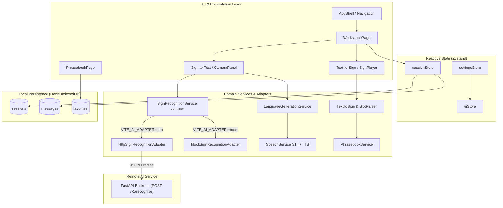

# ConnectSign Frontend — Progressive Web App (PWA)

[](src/test/)
[](tsconfig.json)
[](scripts/check-i18n.js)
[](vite.config.ts)
[](https://bridge-sign.vercel.app/app)

The client application for **ConnectSign — Every Hand Has a Voice**, an installable, offline-first Progressive Web App built with React, TypeScript, and Vite. ConnectSign facilitates bidirectional communication between Algerian Sign Language (LSA / لغة الإشارة الجزائرية) signers and hearing non-signers in frontline medical and pharmacy settings.

- **Production Application:** [https://bridge-sign.vercel.app/app](https://bridge-sign.vercel.app/app)
- **Backend Documentation:** [../backend/README.md](../backend/README.md)
- **Root Repository Overview:** [../README.md](../README.md)

---

## 1. Frontend Overview

The ConnectSign frontend is a responsive, client-side web application designed to operate in noisy, low-connectivity clinical environments such as pharmacy counters, clinic triage desks, and emergency intake areas.

### Role in the ConnectSign Ecosystem
- **Camera Capture & Vision Ingestion:** Accesses the device camera, tracks upper-body and hand landmarks using `@mediapipe/tasks-vision`, and manages video frame decimation.
- **Client-Side Natural Language Processing:** Normalizes spoken or typed natural language, extracts dosage and duration patterns, and performs fuzzy matching against LSA gloss sequences entirely in the browser.
- **Sign Playback (`SignPlayer`):** Renders sequential sign clips with synchronized multilingual captions and honest placeholder cards when video assets are in production.
- **Offline Data Sovereignty:** Persists conversations, messages, and phrasebook bookmarks locally in IndexedDB using Dexie, ensuring patient data never leaves the device.
- **Decoupled Recognition Architecture:** Communicates with the FastAPI backend via an swappable adapter interface (`ISignRecognitionAdapter`), supporting both local/remote AI inference and an offline scripted demo mode.

---

## 2. Implemented Frontend Capabilities

### Text-to-Sign / Language-to-Sign
- **Input Ingestion:** Hearing users communicate by typing or using browser speech recognition (`webkitSpeechRecognition` / `SpeechRecognition`).
- **Slot & Dosage Extraction:** Identifies numbers, durations, and medical frequencies (e.g. *"2 comprimés par jour pendant 5 jours"* $\rightarrow$ `['DOSE_TWO', 'PER_DAY', 'DURATION_FIVE_DAYS']`).
- **Fuzzy Damerau-Levenshtein Matching:** Tolerates spelling variations and grammatical inflections when matching against the curated dictionary.

### Sign Content Display & Playback
- **`SignPlayer` Component:** Renders verified LSA sign clips with playback speed controls (0.5x, 1.0x, 1.5x), step forward/backward navigation, and synchronized captions in French, Arabic, and English.
- **Honest Placeholder Handling:** When video assets are pending studio production, `SignPlayer` displays an honest informational card detailing the verified gloss without generating misleading synthetic 3D animations.

### Curated Frontline Phrasebook
- **87 Medical & Everyday Phrases:** Categorized across symptoms, medications, appointments, emergencies, and everyday interactions.
- **Instant Search:** Multi-attribute fuzzy search indexing French, Arabic, English, and sign gloss tokens.
- **Persistent Favorites:** One-click bookmarking saved to IndexedDB for immediate triage access.

### RTL & Trilingual Support
- **Native Right-to-Left (RTL):** Comprehensive RTL layout mirroring for Arabic (`dir="rtl"`), including icon mirroring and logical layout flow.
- **Synchronized Dictionaries:** 730 translation keys fully synchronized with zero missing translations across `fr.json`, `ar.json`, and `en.json`.

### Responsive Design & PWA Installation
- **Form Factors:** Optimized for desktop triage screens, tablets, and mobile devices (320px viewport minimum).
- **Standalone PWA:** Installable via browser address bar or native home-screen shortcuts on Android and iOS.

### Local Persistence & Privacy
- **IndexedDB (`connectsign`):** Tracks sessions, messages, and favorites locally.
- **Soft Deletion with 5-Second Undo:** Protects medical conversation histories from accidental deletion via a timed undo window.
- **Database Migration:** Idempotently migrates data from legacy `lsa-bridge` schemas if present.

### Sign-to-Text UI & Backend Integration
- **Camera Panel & Landmark Overlays:** Live camera preview with optional real-time skeleton overlay for visual feedback.
- **Dual Adapter Architecture:**
  - `HttpSignRecognitionAdapter`: Dispatches 16-frame bursts to the FastAPI backend (`POST /v1/recognize`), equipped with a 25-second timeout and retry logic for cloud cold starts.
  - `MockSignRecognitionAdapter`: Standalone client-side mock simulating realistic recognition timings and confidence tiers for demos and automated testing.
- **Sentence Builder & Confirmation:** Assembles recognized glosses into proposed natural language sentences with a human-in-the-loop confirmation barrier before spoken synthesis (TTS).

---

## 3. Frontend Technology Stack

| Category | Technology | Version | Purpose |
|---|---|---|---|
| **Framework** | React | `18.3.1` | Component-driven user interface |
| **Language** | TypeScript | `5.7.2` | Strict static type checking |
| **Build Tool** | Vite | `5.4.11` | Rapid development server and Rollup production bundling |
| **Styling** | Tailwind CSS | `3.4.17` | Utility-first styling with custom accessible design tokens |
| **Routing** | React Router | `6.28.1` | Client-side routing with lazy-loaded code-splitting |
| **State Management** | Zustand | `5.0.3` | Lightweight reactive stores for session, UI, and settings |
| **Persistence** | Dexie.js | `4.0.11` | Typed IndexedDB wrapper for local storage |
| **Localization** | i18next & react-i18next | `23.16.8` / `15.4.1` | Trilingual translation engine with RTL detection |
| **PWA & Caching** | vite-plugin-pwa (Workbox) | `0.21.1` | Service Worker pre-caching and web app manifest |
| **Icons** | Lucide React | `0.469.0` | Accessible SVG icon library |
| **Testing** | Vitest & Testing Library | `2.1.8` / `16.1.0` | Unit, integration, and UI component tests |

---

## 4. Frontend Architecture



### Routing Hierarchy
Application routes are configured in `src/app/router.tsx` with lazy-loaded page boundaries:
- `/`: Public entry point (`PublicEntryPage`)
- `/app/onboarding`: First-time user preference setup (`OnboardingPage`)
- `/app`: Authenticated AppShell containing:
  - `index`: Dashboard triage view (`DashboardPage`)
  - `new`: Conversation setup and mode selector (`NewConversationPage`)
  - `workspace/:sessionId`: Active communication workspace (`WorkspacePage`)
  - `sign-to-language`: Dedicated camera recognition mode (`SingleModePage`)
  - `language-to-sign`: Dedicated text and speech translation mode (`SingleModePage`)
  - `phrasebook`: Categorized phrases with search and favorites (`PhrasebookPage`)
  - `stories`: Case scenarios and feedback submission (`StoriesPage`)
  - `history` & `history/:sessionId`: Past conversation transcripts (`HistoryPage`)
  - `diagnostics`: System readiness and latency telemetry (`DiagnosticsPage`)
  - `settings`: Font size, high contrast, adapter toggle, audio (`SettingsPage`)
  - `about`: Project mission, ethical commitments, and credits (`AboutPage`)
  - `design`: Design system token showcase (`DesignPage`)

---

## 5. Project Structure

```
frontend/
├── docs/                             # Engineering documents, ADRs, test protocols
│   ├── a11y-manual-test.md           # WCAG 2.2 AA manual verification checklist
│   ├── api-contract.md               # Backend API and adapter contract specification
│   ├── architecture.md               # Detailed architectural design
│   ├── decisions.md                  # Architectural Decision Records (ADRs)
│   ├── jury-demo-script.md           # 3-minute jury evaluation walkthrough script
│   └── sign-clips-guide.md           # Studio LSA video recording and asset guidelines
├── public/                           # Static assets, PWA icons, offline fallback
│   ├── icons/                        # PWA adaptive and maskable icons (192px, 512px)
│   ├── signs/
│   │   └── manifest.json             # Sign clip duration and placeholder catalog
│   ├── apple-touch-icon.png          # iOS home screen icon
│   ├── favicon.ico                   # Browser favicon
│   ├── manifest.webmanifest          # W3C Web App Manifest
│   └── offline.html                  # Network-disconnected fallback view
├── scripts/
│   ├── check-i18n.js                 # Script validating trilingual key synchronization
│   └── generate-icons.js             # SVG to PNG PWA icon build script
├── src/
│   ├── app/                          # App shell, routing, error boundaries, providers
│   ├── components/
│   │   ├── domain/                   # Domain components (CameraPanel, SignPlayer, EmergencySheet)
│   │   └── ui/                       # Accessible primitives (Button, Modal, Sheet, Toast, Kbd)
│   ├── data/                         # Phrasebook (87 items), vocabulary (54 signs), demo data
│   ├── features/                     # Page view features (workspace, phrasebook, history, etc.)
│   ├── hooks/                        # React hooks (useCamera, useRecognitionMachine)
│   ├── i18n/                         # Trilingual localization dictionaries (fr.json, ar.json, en.json)
│   ├── lib/                          # Utilities (fuzzy matching, time, confidence, a11y)
│   ├── services/                     # Dexie DB, audio TTS/STT, NLP, sign-recognition adapters
│   ├── stores/                       # Zustand state stores (session, settings, ui, demo, profile)
│   ├── test/                         # 17 Vitest test suites (113 passing tests)
│   └── types/                        # Domain models, service interfaces, TypeScript contracts
├── .env.example                      # Environment variable template
├── package.json                      # Dependencies and lifecycle scripts
├── tailwind.config.js                # Tailwind CSS configuration with brand design tokens
├── tsconfig.json                     # Strict TypeScript compiler options
├── vercel.json                       # Vercel deployment and HTTP security headers
├── vite.config.ts                    # Vite build and Workbox PWA configuration
└── vitest.config.ts                  # Vitest test runner configuration
```

---

## 6. Prerequisites and Installation

### Prerequisites
- **Node.js:** `^18.0.0`, `^20.0.0`, or `^22.0.0`.
- **Package Manager:** `npm >= 9.0.0`.

### Step 1: Install Dependencies
```bash
cd frontend
npm install
```

### Step 2: Configure Environment
Copy the example environment configuration:
```bash
cp .env.example .env
```

### Step 3: Run the Development Server
```bash
npm run dev
```
Open [http://localhost:3000](http://localhost:3000) (or the port Vite selects if 3000 is occupied).

### Step 4: Build for Production
```bash
npm run build
```
This compiles TypeScript (`tsc`), builds optimized static assets into `dist/`, and generates the Workbox service worker (`sw.js`).

### Step 5: Preview the Production Build
```bash
npm run preview
```

---

## 7. Environment Variables and API Integration

| Variable | Type | Default | Description |
|---|---|---|---|
| `VITE_APP_NAME` | string | `ConnectSign` | Application header and manifest name. |
| `VITE_AI_ADAPTER` | string | `http` | Active recognition adapter (`http` or `mock`). |
| `VITE_API_BASE_URL` | string | `https://connect-sign.onrender.com` | Base URL for FastAPI backend inference. |
| `VITE_WS_URL` | string | `wss://connect-sign.onrender.com/ws/recognize` | WebSocket endpoint placeholder. |
| `VITE_CONFIDENCE_THRESHOLD`| float | `0.70` | Default visual threshold for gesture detection. |
| `VITE_CONFIDENCE_HIGH` | float | `0.85` | Threshold for high-confidence visual tier. |
| `VITE_SEQUENCE_FRAMES` | integer| `48` | Sliding window temporal frame buffer. |
| `VITE_APP_VERSION` | string | `0.1.0` | Application semver string. |

### Backend Discovery & Fallback
The `HttpSignRecognitionAdapter` reads `VITE_API_BASE_URL`. In production, it defaults to the deployed Render service (`https://connect-sign.onrender.com`). To point to a local backend instance during development, set in `.env`:
```ini
VITE_API_BASE_URL=http://localhost:8000
```
Requests include an `AbortController` timeout of 25 seconds with 2 automatic retries to handle Render cold starts gracefully.

---

## 8. PWA and Offline Behavior

The application is configured using `vite-plugin-pwa` with a Workbox service worker:

### Caching Strategy
- **Application Shell & Static Assets:** All compiled JavaScript, CSS, HTML, icons, and web fonts are pre-cached on initial installation.
- **Navigation Requests (`request.mode === 'navigate'`):** Handled via `NetworkFirst` with a 3-second network timeout. If offline, the cached `index.html` or `offline.html` is returned.
- **Backend API Requests (`/v1/*`):** Configured as `NetworkOnly` to avoid caching stale inference predictions.

### Offline Availability Matrix
| Feature | Offline Status | Operational Details |
|---|---|---|
| **Phrasebook & Search** | Fully Available | 87 phrases and indexed search execute entirely client-side. |
| **Favorites & History** | Fully Available | Stored in IndexedDB; viewable and editable offline. |
| **Text-to-Sign Engine** | Fully Available | Regex slot parsing and fuzzy gloss mapping run locally. |
| **Emergency Sheet** | Fully Available | Offline-capable emergency distress communication. |
| **Sign-to-Text (Mock)** | Fully Available | Scripted pharmacy demo mode operates without a network connection. |
| **Sign-to-Text (Live AI)**| Requires Network | Calls FastAPI backend (`POST /v1/recognize`). Fails gracefully with a retryable offline notice. |

---

## 9. Localization and Accessibility

### Trilingual Synchronization
ConnectSign provides full parity across 730 i18n keys in:
- **Français (`fr`)**: Primary medical lingua franca in Algerian clinical administration.
- **العربية (`ar`)**: Official language with full Right-to-Left (RTL) layout mirroring.
- **English (`en`)**: International accessibility and documentation standard.

Translations are audited using an automated CI check:
```bash
npm run i18n:check
# Output: ✓ i18n parity check passed: 730 keys synchronized across fr, ar, en.
```

### Accessible Design Standards
- **Color Contrast:** Text and interactive elements adhere to strict contrast targets (e.g. Primary button `#0F766E` on white achieves **5.4:1**, exceeding the 4.5:1 requirement).
- **Focus Management:** Modals and slide-in sheets trap keyboard focus; `Escape` closes overlays and restores focus to the trigger element.
- **Live Announcements:** Dynamic status changes (e.g. camera activation, detected gestures) are announced to screen readers via `aria-live="polite"`.
- **Visual Modes:** Supports High Contrast mode (`hc`) and respects `prefers-reduced-motion`.
- **Protocol:** See [`docs/a11y-manual-test.md`](docs/a11y-manual-test.md) for the manual assistive technology testing matrix.

---

## 10. Testing and Quality Checks

The frontend includes 17 test suites executed via Vitest, covering domain services, state stores, UI flows, and accessibility:

```bash
# Run the complete test suite once
npm run test

# Run tests in continuous watch mode
npm run test:watch

# Verify TypeScript type correctness without emitting output
npm run typecheck

# Validate i18n translation key parity across all languages
npm run i18n:check
```

### Actual Verification Results
- **Vitest:** 17 test files passed, 113 individual tests passed.
- **Typecheck (`tsc --noEmit`):** 0 errors.
- **i18n Parity Check:** 730 keys synchronized across French, Arabic, and English.

---

## 11. Troubleshooting

| Symptom | Probable Cause | Recommended Action |
|---|---|---|
| Camera permission error (`CAM-001`) | User denied browser webcam access | Reset camera permissions in browser site settings and reload the page. |
| "Recognition timeout (server may be waking up)" (`AI-002`) | Render free-tier service cold start | Wait 25–30 seconds for the backend instance to spin up; the adapter will retry automatically. |
| Port 3000 in use | Another service is using port 3000 | Vite will automatically suggest port 3001 or 5173. Update `.env` or use the assigned port. |
| Arabic text alignment issues | Incorrect text direction attribute | Ensure `dir="rtl"` is applied to the root element when Arabic is active. |

---

## 12. Contributing to the Frontend

1. **Adding Phrasebook Entries:** Add new entries to `src/data/phrasebook.ts` ensuring all three languages (`fr`, `ar`, `en`) and valid LSA glosses are specified.
2. **Adding Localization Keys:** Add keys simultaneously to `src/i18n/fr.json`, `src/i18n/ar.json`, and `src/i18n/en.json`, then run `npm run i18n:check`.
3. **Modifying UI Components:** Ensure any new interactive elements support keyboard navigation, include visible focus rings, and provide accessible labels.
4. **Code Quality:** Ensure `npm run typecheck` and `npm run test` pass before committing.

---

## 13. Related Documentation

- **Root Project Overview:** [../README.md](../README.md)
- **Backend & Inference API Reference:** [../backend/README.md](../backend/README.md)
- **Architecture Decision Records:** [docs/decisions.md](docs/decisions.md)
- **Manual Accessibility Protocol:** [docs/a11y-manual-test.md](docs/a11y-manual-test.md)
- **LSA Studio Recording Guide:** [docs/sign-clips-guide.md](docs/sign-clips-guide.md)
